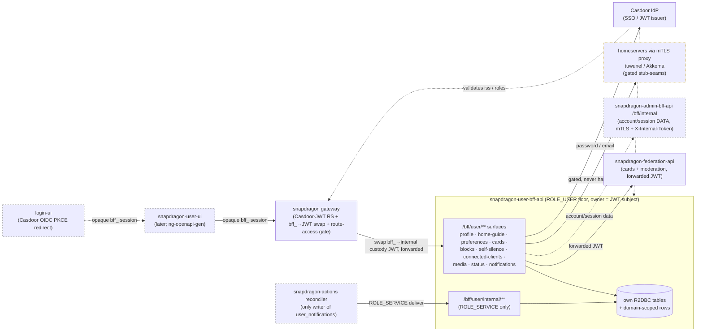

# snapdragon-user-bff-api

Spring **user BFF** — the `ROLE_USER`-floor backend-for-frontend paired with the
(later) `snapdragon-user-ui`. Reactive WebFlux + R2DBC + Liquibase + Casdoor JWT
resource-server + springdoc + Spring Native, scaffolded from the
`snapdragon-admin-bff-api` template (same stack, same conventions). Java 21,
Spring Boot 4.0.2 / Spring Cloud 2025.1.

## Where it sits

A **backend-namespace BFF** — deployed into `snapdragon-backend`, reached only
*behind the gateway*, never public. It is the per-role backend-for-frontend for
ordinary users, the `ROLE_USER` peer of `snapdragon-admin-bff-api` (admin) and the
mod BFF. It talks to:

- **Casdoor** (the IdP) as an OAuth2 resource server — validates the JWT, and is
  the destination for the self-service password/email change. Casdoor is the SSO
  IdP for the whole platform; `login-ui` runs the OIDC authorization-code (PKCE)
  redirect and this BFF does the server-side code→token exchange and holds per-session
  JWT custody/refresh (see *Auth model / SSO relocation*).
- **snapdragon-federation-api** — for the caller's federation **cards** (bundles)
  and the instance-block **recommendation** chain (caller JWT forwarded per request).
- **snapdragon-admin-bff-api** `/bff/internal` (over mTLS + `X-Internal-Token`) — the
  account/session **data** for the relocated login/session/account surfaces stays in
  `admin-bff-db`; this BFF reaches it server-to-server (see *Auth model*).
- the **homeservers** (tuwunel / Matrix, Akkoma / Mastodon) **through the gateway
  mTLS proxies** — for the external block push, self-silence visibility hides,
  connected-client list/revoke, and the AI-cloak media upload. These legs are
  **gated stub-seams** that never hard-fail (see *Honest deferrals*).

In the diagram: solid nodes/edges are ✅ shipped on `main`; dashed nodes are 🔭 planned
or built/landing elsewhere (`login-ui`, `snapdragon-user-ui`, the `snapdragon-actions`
reconciler, and the in-flight admin-bff→user-bff login/session relocation), and the
amber-dashed homeserver leg is the ✅-shipped-but-**gated** stub-seam (off by default).

## Auth model / SSO relocation 🚧

The platform's auth is being consolidated this cycle, and this BFF is the new home
for the user-facing slice of it. Ground truth as of 2026-06-20:

- **Casdoor is the SSO IdP.** `login-ui` performs a Casdoor OIDC authorization-code
  (PKCE) redirect; **this BFF does the server-side code→token exchange** and holds
  per-session **JWT custody / refresh**. The browser only ever holds an **opaque
  `bff_`-prefixed session** (localStorage or httpOnly cookie) — the user NEVER sees
  their own Casdoor JWT.
- **The gateway stays a pure Casdoor-JWT OAuth2 resource server.** A pre-security
  exchange filter swaps the `bff_` session → the internal custody JWT, so the
  gateway's JWT validation + role gate run unchanged.
- **Authorization is data-driven.** The `gateway_route_access` Postgres table is the
  source of truth, enforced by the gateway's `GatewayRouteAccessFilter`:
  ADMIN / GAME-MASTER bypass within their own domain, SUPERADMIN cross-domain.
- **Login / session / account logic is RELOCATING from admin-bff to this user-bff;**
  the shared core is extracted to **`snapdragon-auth-core`** (account / session / MFA /
  Casdoor-admin infra). The account/session **DATA stays in `admin-bff-db`** — this
  BFF reaches it via admin-bff `/bff/internal` over **mTLS + `X-Internal-Token`**.
- **Cloudflare** fronts prod.

> ✅ Already on `main` here: the JWT-only `/bff/user/**` surfaces, the Casdoor
> resource-server config, the canonical `CasdoorAuthorities` converter, and
> issuer-keyed domain-scoping. 🚧 In-flight / landing: the server-side code→token
> exchange + `bff_` session custody + the admin-bff `/bff/internal` account/session
> data calls + the `snapdragon-auth-core` adoption. Until that lands, the historical
> note still holds: registration is owned by admin-bff and there is no `/login` or
> `/register` route here.

## The core invariant: owner-enforcement

**Every endpoint operates ONLY on the caller's OWN data.** The owner is ALWAYS the
Casdoor **JWT subject** (`jwt.getSubject()`) — never a path or request-body field. A
user can never read/write another user's profile, preferences, cards, blocks,
self-silence, or connected clients. There is deliberately no `/profile/{userId}`
style route; the only data a caller can address is their own, identified by the
token. The request body's `userId` is ignored on writes (always overwritten with the
JWT subject) so it cannot redirect a write to another user. This is enforced in
EVERY service method and tested at both the service layer (spoofed body, owner+id
scoped delete) and the repository/SQL layer (owner isolation).

## API surface (all under `/bff/user/**`, `ROLE_USER` floor, owner-enforced)

### Profile — `ProfileController` (`/bff/user/profile`)
Own R2DBC `user_profile` table (one row per user; `user_id` = JWT subject = PK).
Fields: `gender, pronouns, timezone, displayName, visibility {public|internal}
(default internal), vanitySubdomainEnabled, vanityUsername, screenReaderName`.

- `GET /bff/user/profile` — my profile (an empty default if none yet).
- `PUT /bff/user/profile` — create/update my profile (body `userId` ignored; the
  vanity username is derived from the **token** — `preferred_username`, then `name`,
  then subject — NOT the body, so the reserved-name guard can't be bypassed).
- `DELETE /bff/user/profile` — delete my profile.
- `POST /bff/user/profile/password` — change my **Casdoor** password.
- `POST /bff/user/profile/email` — change my **Casdoor** email.

Password + email are owned by the **Casdoor IdP**, not this BFF — they go through
a reactive `CasdoorUserClient` (the BFF never stores credentials). See deferrals.

**`displayName` + vanity-username guard** — charset/confusable-checked on every save
(zero-width / bidi / Cyrillic look-alike / reserved-confusable rejected with 400;
`@SafeDisplayName` + the ICU4J `UsernameSkeleton` + `ReservedNames` engine). The
skeleton is a recomputable defence-in-depth cache, never a DB identity — the exact
UNIQUE + the 004 `vanity_username` CHECK remain the DB backstop.

**`screenReaderName` (a11y)** — the ASCII-only aria-label / spoken name a screen
reader announces (`@SafeScreenReaderName` + the `ScreenReaderNames` engine; 008
`screen_reader_name` column). When `displayName` is pure **ASCII** the screen-reader
name **defaults** to it (no prompt); when `displayName` is **non-ASCII** an ASCII
screen-reader name is **required** — a save without one is a **422** the
registration/profile-save flow uses to prompt. A present non-ASCII screen-reader name
is a 400. (The aria-label UI consumption is a later UI-wave task — this carries the
field + validation + default/prompt logic.)

### Home-guide preference — `HomeGuideController` (`/bff/user/home-guide`)
Per-user "getting-started guide dismissed" flag, keyed per guide, stored in the
own R2DBC `user_preference` table as `home-guide-dismissed:<guide>` = `true`. The
role home views read this to show the welcome/getting-started guide only on first
visit.

- `GET  /bff/user/home-guide?guide=<g>` — `{guide, dismissed}` (default guide `home`).
- `POST /bff/user/home-guide/dismiss?guide=<g>` (and `PUT` alias) — dismiss.
- `DELETE /bff/user/home-guide/dismiss?guide=<g>` — re-show (un-dismiss).

### Durable user preferences — `UserPreferencesController` (`/bff/user/preferences`)
DURABLE per-user UI preferences in the own R2DBC `user_preferences_store` table,
keyed by the JWT subject **and** the brand (domain is part of the composite PK
`(user_id, pref_key, domain)`), so a multi-brand owner keeps a separate,
owner-isolated value per brand. The compose surfaces (the mastodon/matrix AI-poison
toggle) and other UI-wave toggles read/persist here so a choice survives a reload /
device change instead of living only in the browser. Owner = JWT subject;
domain-scoped (SUPERADMIN unscoped); `@PreAuthorize("hasRole('USER')")`. `GET`
returns the resolved view (every stored value **plus** the server default merged in
for any unset known preference), `PUT` upserts one preference (key + value
validated).

- `GET /bff/user/preferences` — `{ "<key>": "<value>", ... }`. Carries
  `media.poison.default` — the per-user durable AI-poison default whose fallback
  **mirrors** the server `MediaPoisoningProperties.defaultMode`.
- `PUT /bff/user/preferences` — body `{ "key": ..., "value": ... }`; upserts and
  returns the resolved view. The AI-poison default must be a valid cloak mode
  (`glaze|nightshade|light|none`).

The read-only `GET /bff/user/media/capability` `defaultMode` (the *server* policy
default) is unchanged — this endpoint layers the per-*user* durable override on top.

### Cards — `CardsController` (`/bff/user/cards`)
CRUD over the caller's OWN federation bundles (`user_modules` in
`snapdragon-federation-api`), via the reactive `FederationApiClient`. The caller's
JWT is **forwarded per request** so federation-api scopes `/bundles/mine` (and
records bundle ownership on PUT) to the same subject — owner-enforcement holds
end-to-end with no broader service credential.

- `GET /bff/user/cards` → federation `GET /api/federation/bundles/mine`.
- `GET /bff/user/cards/{slug}` → federation `GET /api/federation/bundles/slug/{slug}`.
- `PUT /bff/user/cards/{slug}` (octet-stream) → federation `PUT /api/federation/bundles/{slug}`.

### Self-block + recommend-instance-block — `BlockController` (`/bff/user`)
Own R2DBC `user_block` table (`user_id, target, platform {matrix|mastodon|internal},
ts`).

- `GET /bff/user/blocks` — my self-blocks.
- `POST /bff/user/blocks` — record a durable block row (under me) **then**
  best-effort push the external mute/block to Matrix/Mastodon (STUBBED — see
  deferrals). The row is the source of truth even if the push is stubbed/fails.
  **PLATFORM-ROLE GATED:** a `matrix` block requires `ROLE_MATRIX`, a `mastodon`
  block requires `ROLE_MASTODON` (an `internal` block needs only the `ROLE_USER`
  floor) — a principal that does not hold the platform's access role cannot push an
  external mute to a homeserver it has no access to.
- `DELETE /bff/user/blocks/{id}` — remove one of my blocks (scoped by owner AND id).
- `POST /bff/user/recommend-instance-block` — start the **USER → MOD → ADMIN**
  instance-block chain via federation `POST /api/federation/moderation`
  (`kind=instance-block`; federation sets `status=recommended` server-side). This
  is a *recommendation*, not a self-block, and requires a homeserver platform role
  (`ROLE_MATRIX` OR `ROLE_MASTODON`).

The platform-role gate is **two-leg defence-in-depth**: a method-level
`@PreAuthorize` (SpEL on the validated request-body `platform`) is the API leg;
`BlockService` re-checks the SAME platform role against the caller's authorities
(service leg) so the rule holds even if a caller reaches the service by another path.
`ROLE_MATRIX`/`ROLE_MASTODON` map automatically via the Casdoor authorities
converter — no converter change.

### Self-silence — `SelfSilenceController` (`/bff/user/self-silence`)
Self-service **visibility hide** — a user makes THEMSELVES invisible to others for a
bounded window while keeping their own full session/access. It is **NOT a ban**: this
surface is structurally incapable of writing a Casdoor role, an `access_suspension`
row, or a revocation key — login/home stays normal for the silenced user. Own R2DBC
`self_silence` table (006; `expires_at` authoritative; a `@Scheduled`
`SelfSilenceExpiryAction` auto-clears at expiry). `activate()` is atomic/idempotent
(INSERT-or-UPDATE upsert, closing the 23505 race).

- `POST /bff/user/self-silence/activate` — hide me until `expiresAt` (REQUIRED,
  must be in the FUTURE; `reason` optional). I keep my session + full access.
- `GET  /bff/user/self-silence/status` — my current silence (active or cleared).
- `POST /bff/user/self-silence/cancel` — un-silence myself now (un-hide + clear).
- `POST /bff/user/self-silence/email-mod` — ask a mod/admin to reactivate me sooner
  (writes a self-silence-appeal moderation request; NOT SMTP).

The homeserver localpart used for the visibility-hide seams comes from the JWT
`preferred_username` claim. All three hide legs are **gated stub-seams that never
hard-fail**: the federation user-scope hide-profile apply/clear leg
(`self-silence.federation.enabled`) and the homeserver directory/discovery hides
(`external.matrix.enabled` / `external.mastodon.enabled` — tuwunel
exclude-from-directory, akkoma `discoverable=false`) are all OFF by default; the
durable `self_silence` row stands regardless.

### Connected apps & devices — `ConnectedClientsController` (`/bff/user/connected-clients`)
The caller's native OAuth apps (Element / Tusky / Ivory) + device sessions registered
against the homeservers (akkoma / Matrix) **through the gateway passthrough**. Own
R2DBC `connected_client_audit` table (`owner, platform {matrix|mastodon}, client_kind
{oauth-app|device}, external_ref, label, created_at, revoked_at`; 009). The live
homeserver sessions are listed/revoked via the homeserver client API **through the
mTLS proxy** (a GATED stub-seam, never hard-fail); the audit row is the BFF-owned
durable record.

**EXTERNAL-CLIENT-ROLE GATE** — this surface requires an external-client role
(`ROLE_MATRIX_EXTERNAL_CLIENT` / `ROLE_MASTODON_EXTERNAL_CLIENT`), which is **separate**
from the base `ROLE_MATRIX` / `ROLE_MASTODON` our-UI access: the external-client role
gates whether a user may register/use a **native** client. Class-level `@PreAuthorize`
(API leg, at least one external-client role to reach the surface at all) + a
per-platform service re-check (service leg) so a matrix-only caller cannot revoke a
mastodon client and vice-versa. The roles map automatically via the Casdoor
authorities converter — no converter change.

- `GET /bff/user/connected-clients` — my connected apps + device sessions.
- `DELETE /bff/user/connected-clients/{id}` — revoke one of mine: write the
  **per-credential** gateway revocation key `hs:<platform>:<localpart>:<appId|deviceId>`
  first (`RevocationWriter`), best-effort homeserver delete, then stamp `revoked_at`.

Removing the external-client role → `ConnectedClientsService.reconcilePersonalClient
Revocation` writes `external-client:<localpart>:<platform>` (the gateway filter checks
it only for `kind=personal` tokens, so base our-UI access is unaffected).

### AI-cloak media proxy — `MediaPoisonController` (`/bff/user/media`)
The **poison-before-ingest** seam. The UIs route uploads through this BFF endpoint
**instead of POSTing media directly to the homeserver**, so the AI-cloak
(Glaze-style cloak / Nightshade-style poison) happens *before* any homeserver sees
the bytes, owns **every served size**, and the decision is recorded **server-side**
(`media_poison_decision` = audit + badge + repost source of truth). The prior
direct-to-homeserver path could do none of those — async-after-ingest is placebo
(re-encode strips perturbation, server thumbnails regenerate clean, federation wins
the race).

- `POST /bff/user/media/upload` — multipart (`file` + `platform {matrix|mastodon}` +
  `mode {glaze|nightshade|light|none}` + `roomId`/`description`). **Flow:** sniff the
  bytes (magic-byte, never the client `Content-Type`) → for an image with `mode!=none`
  and a **present** worker, call the poisoner **sync within a latency budget** to cloak
  the **original + every pinned served size** (akkoma `small`; Matrix `240x240`) → do
  the **real homeserver upload of the POISONED bytes** via the mTLS proxy → run the
  **round-trip survival gate** → return the homeserver `media_id`/`mxc` **exactly as
  the homeserver would** (UI compose logic untouched) plus a `cloak` block
  (`status/mode/backend/mediaRef`). Non-image / `mode=none` / feature-off → forwarded
  **through unchanged** (`status=none`).
- `GET /bff/user/media/capability` — worker backend (`cuda|rocm|cpu|none`) + offered
  modes + ETA, so the composer renders an **honest** shield state up front (incl.
  `Unavailable` when the heavy tier is absent).
- `GET /bff/user/media/status/{ref}` — my decision for a media ref (badge polling),
  owner-scoped.

**Round-trip survival gate (the badge never lies):** after the upload the service
re-fetches the served original + thumbnails and runs a perturbation-presence check;
it persists `protected` **only if it survived**, else `degraded`. **Honest copy:**
*"AI-cloak applied"*, never *"protected"* unless the gate passes — best-effort
training-set hygiene (removable by re-encode/downscale), not a guarantee.
**Uncloseable (stated honestly):** already-federated copies + native-client
(Element/Tusky) uploads that skip this BFF entirely.

**Lean fallback (k8s protocol-probe, no heavy tier):** the worker is the **optional**
x86/GPU `snapdragon-media-poisoner`. On a Pi5-only cluster its pod stays `Pending`,
its Service has no Ready endpoints, the `/health` probe reports `backend=none`, and
`app.media.poisoning.fallback-mode` decides: `skip` (default — forward **uncloaked**
with `status=skipped` + a documented signal so the UI warns *"not cloaked"*), `light`
(reduced-strength CPU if offered), or `queue` (placeholder-then-replace). Posting is
never *forced* to block. Ships **dark** by default (`app.media.poisoning.enabled
=false` ⇒ the controller is mounted but every upload forwards through `status=none`)
until the survival gate is verified on a real GPU cluster.

### Account status — `AccountStatusController` (`/bff/user/status`) ✅ shipped
A `ROLE_USER`-floor, owner-scoped, **read-only polling** endpoint. There is no write
path, so it is entirely safe to cache or poll at whatever interval the UI prefers.

- `GET /bff/user/status` → `{ sub, domain, roles, silenced, silenceExpiresAt }`.

Everything is derived from the already-validated JWT authorities (the active `ROLE_*`
list, stripped of the `ROLE_` prefix) + the caller's OWN `self_silence` row (owner =
JWT subject, no BOLA). UIs poll it to detect account-status changes: a suspension
removes roles at Casdoor so the NEXT token refresh reflects the change (the gateway's
revocation filter covers in-flight JWTs), and a self-silence state flip shows up here
without a token refresh. `domain` falls back to `default` for single-issuer clusters.

### Notifications — in-app floor ✅ shipped
The **in-app notification channel** — the always-on channel a user can never silence.
All three surfaces are owner-enforced (owner = JWT subject) and domain-scoped
(SUPERADMIN unscoped); see the [Notifications roadmap](#notifications-roadmap) for the
external channels that build on top.

**Inbox — `UserNotificationController` (`/bff/user/notifications`)** (`ROLE_USER` floor)
- `GET /bff/user/notifications?limit=<n>` — my OWN in-app notifications, newest first,
  server-capped (`limit` bounded to `UserNotificationRepository.MAX_PAGE` = 100,
  default 50).
- `POST /bff/user/notifications/{id}/read` — mark ONE of my own notifications read; an
  id that is not my own owner+domain row is a **404** (no cross-user mark).

**Per-category preferences — `NotificationPreferenceController`
(`/bff/user/notification-preferences`)** (`ROLE_USER` floor) — MIRRORS the durable
`UserPreferencesController` shape.
- `GET` — my resolved per-category preferences (every known category defaults
  **enabled**, my explicit choices merged in).
- `PUT` — body `{ "category": ..., "enabled": ... }`; upsert ONE category, returns the
  resolved view. `account-restriction` is **forced-on / un-silenceable**: an
  `enabled=false` for it is COERCED to enabled (API-coerced + a DB CHECK backstop), so
  the durable row and the view always show it on.

**Internal deliver — `InternalNotificationController`
(`/bff/user/internal/notifications`)** — **SERVICE-PRINCIPAL ONLY.**
- `POST /bff/user/internal/notifications` — the ONLY production writer of
  `user_notifications`; the `snapdragon-actions` reconciler calls it.
- The target `(domain, userSubject)` comes from the **request body** (the service acts
  on behalf of the SYSTEM for a named user — NOT owner==caller), which is exactly why
  it must be unreachable by any human JWT. `SecurityConfig` gates the
  `/bff/user/internal/**` prefix to `ROLE_SERVICE` **exclusively** — declared BEFORE
  the `/bff/user/**` authenticated rule, and deliberately NOT `hasAnyRole(SERVICE,
  ADMIN, SUPERADMIN)`, so even SUPERADMIN is DENIED here — plus a method-level
  `@PreAuthorize("hasRole('SERVICE')")`. `ROLE_SERVICE` is the platform service-account
  role (a Casdoor client-credentials token carries it; no human login does — the same
  mechanism federation-api uses for its internal username oracle).
- Honours the per-category preference (`account-restriction` forced-on) and is
  **idempotent**: the row id is a deterministic hash of the source event
  (`sourceTable`+`sourceId`), so a retry is INSERT-IF-ABSENT (a duplicate returns
  `delivered=true, deduped=true`, never a second row).

> **SHIPS DARK (in-app floor MVP):** the read/mark-read + prefs surfaces are live and
> the SERVICE-only deliver endpoint exists, but nothing writes `user_notifications` in
> normal operation yet — the `snapdragon-actions` reconciler (a separate repo, later PR)
> is the only writer. This is the read/prefs/deliver-seam side of the feature.

## Where data lives (the routing rule)

| Concern | Destination |
| --- | --- |
| Profile fields (incl. screenReaderName), home-guide prefs, durable user preferences, self-block rows, self-silence rows, media-poison decisions, connected-client audit, in-app notifications + per-category prefs | **own R2DBC tables** (`user_profile`, `user_preference`, `user_preferences_store`, `user_block`, `self_silence`, `media_poison_decision`, `connected_client_audit`, `user_notifications`, `notification_preference`) |
| Account / session data for the relocated login/session surfaces | **`snapdragon-admin-bff-api` `/bff/internal`** (mTLS + `X-Internal-Token`; data stays in `admin-bff-db`) |
| Password / email change | **Casdoor IdP** (`CasdoorUserClient`) — never stored here |
| Cards (federation bundles) + instance-block recommendation + (later) self-silence federation hide | **snapdragon-federation-api** (reactive `FederationApiClient`, forwarded JWT) |
| External mute/block push, self-silence directory hide, connected-client list/revoke, media upload | **Matrix (tuwunel)** / **Mastodon (Akkoma)** clients via the gateway mTLS proxy (STUBBED/gated) |
| Homeserver-token revocation keys | **gateway revocation list** (`RevocationWriter`, gated stub-seam until the gateway write endpoint ships) |

## Clients

- `FederationApiClient` — reactive WebClient of federation-api. Base URL
  `FEDERATION_API_BASE_URL` (default
  `http://snapdragon-federation-api.snapdragon-backend.svc.cluster.local:8080`).
  A token-injecting `ExchangeFilterFunction` re-injects the caller's JWT from the
  reactive security context as `Authorization: Bearer <jwt>` on every outbound
  call (`FederationWebClientConfig`).
- `CasdoorUserClient` — reactive WebClient for self-service password/email
  (`/api/set-password`, `/api/update-user`). Gated by `casdoor.account.enabled`.
- `MatrixBlockClient` / `MastodonBlockClient` (behind the `ExternalBlockClient` /
  `ExternalBlockConfig` abstraction seam) — reactive WebClients for the
  external self-block push. Base URLs grounded in the snapdragon-generator
  manifests: tuwunel `:8008` (`MATRIX_URL`), Akkoma `:4000` (`MASTODON_URL`).
  Gated by `block.matrix.enabled` / `block.mastodon.enabled`.
- `MatrixHideClient` / `MastodonHideClient` (behind the `HomeserverHideClient` /
  `HomeserverHideConfig` abstraction seam) — reactive WebClients for the
  self-silence directory/discovery hide seams. Gated by `external.{matrix,mastodon}
  .enabled`.
- `MatrixClientsClient` / `MastodonClientsClient` (behind the `HomeserverClientsClient`
  seam) — reactive WebClients for the
  connected-clients list/revoke against the homeserver client API (through the mTLS
  proxy). `RevocationWriter` writes the gateway per-credential revocation keys.
- `PoisonWorkerClient` / `HomeserverMediaClient` — the media-proxy worker call +
  the real homeserver upload/re-fetch through the akkoma-proxy / tuwunel-proxy mTLS
  proxies (`app.media.proxy.{matrix,mastodon}.*`).

## Security — defence in depth

`SecurityConfig` is a Casdoor OAuth2 resource server (`issuer-uri` from
`CASDOOR_ISSUER_URI`). The JWT→authority converter is the **verbatim** Casdoor
converter shared with `snapdragon-admin-bff-api` / the gateway: `ROLE_USER` floor on
every authenticated principal; `roles` (string or `{name}`) → `ROLE_<UPPER>`;
`permissions` verbatim; `isAdmin` → `ROLE_ADMIN`. `@EnableReactiveMethodSecurity`
+ `@PreAuthorize` on the controllers re-checks at the method (the `ROLE_USER` floor,
plus the per-surface platform / external-client role gates above).
Profile/spec gating is profile-split: under `dev`/`test` the OpenAPI spec + Swagger
UI are public (so `gen:fetch` can curl `/v3/api-docs` tokenless); in prod they need
`ROLE_ADMIN`. Actuator health/info are public for probes.

This BFF is the per-session JWT custodian behind the gateway's `bff_`-opaque-session
model (see *Auth model / SSO relocation*): the browser holds only the opaque `bff_`
session, the gateway swaps it to the internal custody JWT before its own validation,
and authorization at the edge is data-driven by `gateway_route_access` /
`GatewayRouteAccessFilter` in the gateway. Inside this BFF the post-validation JWT is
the only authority source.

### Shared org artifacts (`snapdragon-parent` + `snapdragon-commons` + `snapdragon-auth-core`)

This service adopts the org's shared Maven artifacts. Three de-duplication moves:

1. **Parent POM →** `systems.snapdragon:snapdragon-parent:2.0.0` (itself a child of
   `spring-boot-starter-parent:4.0.2`, so the whole Spring Boot dependency/plugin
   management is inherited transitively). The parent consolidates the reactive-BFF
   `<dependencies>` (webflux/actuator/security/oauth2-resource-server/validation,
   R2DBC + Liquibase + JDBC, springdoc, the full test stack) and the
   `dependencyManagement` for `snapdragon-commons` + springdoc + the surefire/native
   plugin config. Only the **repo-specific** deps stay in this POM: `icu4j` and
   `commons-text` (the Unicode confusable / typo-squat guard).

2. **Shared security/tenancy/web →** `systems.snapdragon:snapdragon-commons:2.0.0`.
   The local copies of `security.{Roles,DomainRegistry,CasdoorAuthorities,DomainScope}`,
   `config.TenancyResourceServerConfig` and `web.ApiException` were **deleted** and
   replaced by:
   - `commons.security.Roles` — its `Set<String>`/names overloads are
     `isSuperadminNames(...)` / `domainOfNames(...)`; the `isSuperadmin` / `domainOf`
     names take `Collection<? extends GrantedAuthority>` (the form this BFF uses
     directly).
   - `commons.security.DomainRegistry` (same `domainOf`/`isTrusted`/`trustedIssuers`/
     `isMultiIssuer` API).
   - `commons.security.CasdoorAuthorities` (now `public`, methods `public static`;
     `MfaConfig` is a `public record`).
   - `commons.config.TenancyResourceServerConfig` (the config-gated multi-issuer
     wiring).
   - `commons.tenancy.DomainScope` — the static-utility `isUnscoped(String)` / `PARAM`
     the owner-keyed repositories call.
   - `commons.web.ApiException` (the `{"error": msg}` carrier).

   **Stays per-repo:** this repo's `config.SecurityConfig` (route matchers +
   CSRF/cookie/header policy), `web.ApiExceptionHandler`, the test
   `config.SecuritySliceSupport`, and — crucially — **`security.PrincipalDomain`**.
   That class is a `@Component` with this BFF's own `forScope(Jwt)` contract (the
   fail-closed `__deny__` sentinel for a non-SUPERADMIN whose issuer is unresolved),
   which the commons value-type `PrincipalDomain` does NOT provide; it is KEPT and
   its imports were rewired to the commons `Roles`/`DomainRegistry`.

   **Two consumer-wiring steps** (the canonical recipe for the fan-out):
   - `config.CommonsSecurityConfig` `@Import`s the commons `DomainRegistry` +
     `TenancyResourceServerConfig` beans, because the `@SpringBootApplication`
     component-scan over `systems.snapdragon.userbff` does **not** cover the
     `systems.snapdragon.commons.*` packages. (`@Import` preserves
     `TenancyResourceServerConfig`'s `@ConditionalOnExpression` gate.)
   - the multi-issuer security-slice tests reach the package-private
     `TenancyResourceServerConfig.tenantAuthManagerResolver()` through a same-package
     test accessor at `src/test/java/systems/snapdragon/commons/config/TenancyResolvers.java`.

3. **Shared account/session/MFA/Casdoor-admin infra →** `systems.snapdragon:snapdragon-auth-core:2.0.0`
   🚧. As the login/session/account logic relocates from admin-bff into this user-bff,
   the cross-cutting core (account-state, session-custody, MFA, Casdoor-admin client
   infra) is extracted to `snapdragon-auth-core` (depends on `snapdragon-commons`,
   consumed by **user-bff + admin-bff only**) rather than copied. This adoption is
   in-flight alongside the SSO relocation above.

   The committed [`openapi.json`](src/main/resources/openapi/openapi.json) is
   **byte-identical** after the commons refactor (internal-only change).

#### Resolving the private org artifacts

`snapdragon-parent` / `snapdragon-commons` / `snapdragon-auth-core` are **not** on
Maven Central — they live in the org GitLab Maven Package Registry. Two resolution
paths, **no secrets in git**:

- **Local dev:** the shared artifacts are `mvn install`ed into `~/.m2`, so a plain
  `./mvnw test` resolves them locally and never touches the remote (this is how the
  build was verified green).
- **CI / Docker:** the committed [`settings.xml`](settings.xml) declares the
  `gitlab-maven` group registry, authenticated by the GitLab `CI_JOB_TOKEN`
  (`${env.CI_JOB_TOKEN}` — injected by GitLab, never committed). The
  [`Dockerfile`](Dockerfile) multi-stage build runs `./mvnw -s settings.xml package`
  with the token mounted as a **BuildKit secret** (`--mount=type=secret`, so it never
  lands in an image layer); `.gitlab-ci.yml` passes
  `--secret id=ci_job_token,env=CI_JOB_TOKEN` plus the `CI_API_V4_URL` /
  `GITLAB_GROUP_ID` build-args, and the `test:` job passes the same env into the
  build container.

### API-to-API mTLS (PKI identity, both directions)
In-cluster the deployment mounts a PKCS12 keystore (this service's Vault-PKI
identity) + truststore (the cluster CA) and flips on **server-side** client-auth
(`server.ssl.enabled=true`, `client-auth=need`, TLSv1.3 floor): a caller that was
not deployed+signed by our Vault/ESO PKI process holds no chaining cert and its TLS
handshake is rejected before it can read or call the API at all. The **client-side**
half (`snapdragon.mtls.client.enabled`, `FederationHttpClientSsl`) presents this
BFF's client identity on its OUTBOUND federation-api calls (and is the same mechanism
used for the admin-bff `/bff/internal` account/session leg — mTLS + `X-Internal-Token`)
when the upstream flips its server-side client-auth to `need`. Both reuse one mounted
`/stores` layout. Defaults keep local/dev/CI plaintext (`SSL_ENABLED=false`,
client-auth `none`).

### Multi-tenancy / domain-scoping ✅ shipped
The platform is multi-brand: one Casdoor per brand, so a token's
cryptographically-validated `iss` claim is the trustworthy tenant discriminator.
Issuer-keyed domain-scoping is **shipped and active on `main`** — it threads through this
BFF to match the gateway, and is the in-data defence-in-depth layer **beneath** the
authoritative cross-domain boundary (per-domain namespace + mTLS isolation; 1
admin-bff instance ↔ 1 Casdoor org). It is enforced live:

- The JWT→authority mapping uses a shared `CasdoorAuthorities` converter (logic
  shared with the gateway via `snapdragon-commons`) so the BFF and gateway emit
  **byte-identical** authorities. It stamps exactly one issuer-derived `DOMAIN_<x>`
  authority (resolved through a `DomainRegistry` issuer→domain map; unknown issuer →
  `default`), and **strips any `permissions` entry carrying a reserved `ROLE_`/
  `DOMAIN_` prefix** — those authorities come ONLY from controlled logic (roles claim
  / validated issuer), so a brand-X token cannot inject `permissions:["DOMAIN_brandy"]`
  (forged tenant) or `permissions:["ROLE_SUPERADMIN"]` (forged super-role) to escalate
  cross-domain.
- A single-issuer cluster (today's default) resolves `DOMAIN_default` for every
  token and nothing else changes (back-compat). When `app.tenancy.issuers`
  (`${APP_TENANCY_ISSUERS:}`) carries `issuerUri=domain` pairs, the
  config-gated multi-issuer decoder (`TenancyResourceServerConfig`) activates and
  401s an unknown `iss` before authorities are emitted (fail-closed). The
  `.contains('=')` guard means the empty default does NOT spuriously activate it; the
  resolver is only swapped on when `DomainRegistry.isMultiIssuer()`.
- `PrincipalDomain` turns the validated JWT into the effective scope: **SUPERADMIN**
  (the cross-domain infra super-role) → `null` = unscoped (sees/mutates every
  brand's rows); any other principal → its concrete issuer-derived domain (a
  non-SUPERADMIN with an unresolvable issuer fails closed to a non-matchable
  `__deny__` sentinel). `AccountStatusController` and the notification surfaces call
  `PrincipalDomain.forScope` at runtime.
- The data layer adds a per-query `domain` predicate (`DomainScope`: `AND domain =
  :domain`, or NO predicate for the SUPERADMIN bypass) **alongside** — never
  replacing — the existing `owner = :uid` predicate. The 010 changelog adds a
  back-compat `domain varchar(64) default 'default'` column (+ owner+domain indexes)
  to every owner-keyed table. A non-SUPERADMIN principal must satisfy BOTH owner AND
  domain. The domain is never read from a request field — only from the issuer — so a
  caller cannot forge a cross-tenant scope.

> 🔭 **Roadmap (provisioning, not in this repo):** turning `domain_registry` rows into
> a per-brand ArgoCD `ApplicationSet` (namespaces / CA / Casdoor org / gateway / BFF /
> UI) is a later snapdragon-generator PR; multi-issuer **live** wiring beyond
> single-issuer `DOMAIN_default` clusters lands with that provisioning. The code in this
> BFF is ready for it today.

## Stack

Reactive WebFlux everywhere (Mono/Flux, reactive WebClient; no `.block()` /
`Thread.sleep` on the event loop). R2DBC for all runtime data; JDBC only for the
Liquibase migrations (`db/changelog`, **001–012**). 010 = domain-scoping (the
`domain` column on every owner-keyed table); 011 = `user_preferences_store` (the
durable per-user/per-brand preferences table backing `/bff/user/preferences`,
domain-first composite PK `(user_id, pref_key, domain)`); 012 = the notifications
floor (`user_notifications` + `notification_preference`, both owner-keyed +
domain-scoped, `account-restriction` forced-on with a DB CHECK backstop). Spring
Native: `native` profile + native-maven-plugin, surefire `argLine
-Dnet.bytebuddy.experimental=true`, `NativeHintsConfig` with reflection hints for the
JSON-bound DTOs + swagger-ui webjar resource hints. `R2dbcConvertersConfig` maps
Postgres/H2 timestamp types → `Instant` deterministically (JVM + native).
Data-access standard: Spring Data R2DBC reactive repositories (no raw SQL strings /
inline `@Query`).

## Build / test

- `./mvnw test` — green. Coverage: the Casdoor authorities converter; ROLE_USER +
  spec role-gating (`@WebFluxTest`); repository slices over H2-PG-compat with the
  REAL Liquibase changelog (`TestDatabaseConfig`); **owner-enforcement**
  (`ProfileService` ignores a spoofed body userId; `BlockService` unblock is
  owner+id-scoped; repo slices assert owner isolation at the SQL layer); the
  platform-role / external-client-role gates; the username/displayName confusable +
  reserved-name + screen-reader-name guards; the self-silence distinctness
  (no role/suspension/revocation) + round-trip + the atomic/idempotent activate
  upsert; the media-proxy sniff/poison/survival flow; the home-guide dismiss
  round-trip; the federation / Casdoor / Matrix / Mastodon clients + the
  JWT-forwarding filter against a mocked `ExchangeFunction`; the **domain-scoping**
  layer (the `CasdoorAuthorities` reserved-prefix injection guard, `PrincipalDomain`
  scope resolution, `DomainRegistry` issuer→domain mapping, the multi-issuer
  unknown-iss 401 fail-closed security-slice, and a per-table repository
  domain-isolation slice for every owner-keyed table); the wave-2 controller/filter
  HTTP authz (cross-domain DENY + owner==subject + role matrix); the
  **account-status** polling endpoint; the **notifications** floor (inbox + per-category
  prefs + the SERVICE-only idempotent deliver + the `account-restriction` forced-on
  coercion + per-table domain isolation); and a full-context load test.
- `./mvnw package -DskipTests` — builds the runnable jar.
- `./mvnw -Pnative native:compile` — GraalVM native binary (needs a GraalVM host).

CI is **GitLab only** (`.gitlab-ci.yml`); the GitHub repo is pull-mirrored into
in-cluster GitLab. There are deliberately **no `.github/workflows`** (GitHub
Actions is billing-blocked). The pipeline runs **`test`** (`mvn verify` on
`eclipse-temurin:21-jdk-noble`) → **`security`** (OWASP Dependency-Check SCA,
fail-on-CVSS≥9) → **`dast`** (a ZAP API scan against the OpenAPI spec when
`DAST_TARGET_URL` is set, advisory otherwise) → **`build`** (the container image) →
**`pentest`**. The `pentest` stage `include:`s the centralized OWASP harness from
`snapdragon-generator` (`/tests/pentest/ci/pentest-stage.gitlab-ci.yml`), so the
`pentest:sca` / `pentest:dast` jobs `extends:` the shared `.pentest-*` jobs that run
the full harness (Dependency-Check SCA + authenticated ZAP baseline + custom probes +
**nuclei**) from one source of truth. The legacy inline `dependency-check` /
`zap-api-scan` jobs are kept additively alongside it (their migration onto the shared
harness is a follow-up). All security/DAST/pentest jobs are `allow_failure: true`
(advisory, not a hard gate) and scoped to the default branch + merge requests.

> 🔭 **Roadmap (CI):** k6 load testing (part of the platform pen-test standard) is not
> yet wired into this repo's `.gitlab-ci.yml`; nuclei already runs via the shared
> `.pentest-*` jobs above.

## Honest deferrals

- **SSO code→token exchange + `bff_` session custody is landing, not yet on `main`.**
  The JWT-only `/bff/user/**` resource-server surfaces are shipped; the server-side
  authorization-code exchange, the per-session JWT custody/refresh, the `bff_`
  opaque-session, and the admin-bff `/bff/internal` account/session data calls are the
  in-flight relocation slice. Until merged, registration/login stay owned by admin-bff.
- **External Matrix / Mastodon block push is STUBBED.** The clients implement the
  documented shapes (Matrix `PUT .../account_data/m.ignored_user_list`; Mastodon
  `GET /api/v1/accounts/lookup` then `POST /api/v1/accounts/{id}/block`) and the
  reactive flow is fully wired, but the live call is gated OFF by default
  (`block.{matrix,mastodon}.enabled=false`) because it needs the **owning user's**
  per-platform access token (broker via the admin-bff `ServiceTokenBroker`), which
  is out of scope here. When disabled the durable `user_block` row still stands
  and the response carries `external: "stubbed"`. Validate the payloads + token
  brokering against the deployed tuwunel/Akkoma before flipping the flag.
- **Self-silence hide seams are STUBBED.** The durable `self_silence` row + the
  `@Scheduled` auto-clear at `expires_at` are real and authoritative; the federation
  user-scope hide-profile leg and the homeserver directory/discovery hides are gated
  OFF (`self-silence.federation.enabled`, `external.{matrix,mastodon}.enabled`) and
  the real admin verbs are pinned against the deployed servers later.
- **Connected-clients homeserver list/revoke is a gated stub-seam.** The BFF-owned
  `connected_client_audit` row + the gateway per-credential revocation key
  (`RevocationWriter`) are the real enforcement; the live homeserver delete is
  best-effort and the gateway revocation-write endpoint ships later.
- **Casdoor password/email change is STUBBED by default** (`casdoor.account.enabled
  =false`). The reactive `CasdoorUserClient` flow runs end-to-end (controller →
  service → client) and acks `casdoor: "stubbed"`; the exact Casdoor payload +
  per-user auth (caller's own session vs. a service credential, and the
  `send-verification-code`/`verify-code` flow for email) is version-specific and
  must be validated against a running casdoor-all-in-one before going live.
- **AI-cloak media-proxy ships DARK** (`app.media.poisoning.enabled=false`) until
  the round-trip survival gate is verified on a real GPU cluster. The heavy-tier
  worker is optional; the lean fallback never *forces* posting to block.
- **Domain-scoping is ✅ shipped and active.** A single-issuer cluster resolves
  `DOMAIN_default` and behaviour is unchanged (back-compat); the multi-issuer decoder
  + per-query domain predicate are live (see *Multi-tenancy / domain-scoping* above).
  Only the per-brand provisioning (ApplicationSet) and multi-issuer *live wiring* are
  roadmap (in `snapdragon-generator`), not this BFF's code.
- **Notifications floor ships DARK.** The read/mark-read inbox + per-category prefs +
  the SERVICE-only deliver endpoint are wired and tested, but nothing writes
  `user_notifications` in normal operation yet — the `snapdragon-actions` reconciler
  (separate repo, later PR) is the only writer. EXTERNAL channels (Matrix DM / Akkoma
  feed / phpBB / email) are roadmap (see below).
- **Owner-enforcement coverage.** Enforced in EVERY service method (owner = JWT
  subject; body userId ignored) and tested at both the service layer
  (spoofed-body, owner+id-scoped delete) and the repository/SQL layer (owner
  isolation). The federation cards path relies on **federation-api** honoring the
  forwarded JWT for its own `/mine` scoping — the BFF guarantees the correct token
  is forwarded (covered by `FederationWebClientConfigTest`); the upstream scoping
  itself is federation-api's contract, exercised here against a mock, not a live
  federation-api.
- **Native image** is best-effort hint-wise; an authoritative `-Pnative
  native:compile` on a GraalVM host is the real check (not run in this CI).
- **Paired `snapdragon-user-ui`** is built later, NOT here; this BFF's
  `/v3/api-docs` spec is the contract its ng-openapi-gen typed client will consume.

## Current State

State convention: ✅ shipped (on `main`) · 🚧 in-flight (open branch/PR or landing) ·
🔭 planned (design-complete, no code here).

- ✅ **Reactive user BFF on the unified baseline:** Spring Boot 4.0.2 / Spring Cloud
  2025.1, Java 21, WebFlux + R2DBC + Liquibase (001–012), Spring Native hints,
  springdoc OpenAPI.
- ✅ **Casdoor JWT resource server + owner-enforcement** across every `/bff/user/**`
  surface; the canonical `CasdoorAuthorities` converter; `ROLE_SERVICE`-exclusive
  `/bff/user/internal/**`.
- ✅ **Issuer-keyed multi-tenancy / domain-scoping** (per-query `domain` predicate,
  fail-closed unknown-issuer 401, SUPERADMIN cross-domain unscoped).
- ✅ **Shipped feature surfaces:** profile (+confusable/reserved/screen-reader guards),
  home-guide, durable preferences, cards proxy, self-block + instance-block
  recommendation, self-silence (atomic activate), connected-clients audit, AI-cloak
  media proxy (dark), account-status polling, in-app notifications floor (dark).
- ✅ **Org artifact adoption:** `snapdragon-parent:2.0.0` + `snapdragon-commons:2.0.0`
  (shared security/tenancy/web); GitLab-only CI with the shared OWASP pentest harness.
- ✅ **mTLS both directions** (server-side client-auth + client-cert presentation on
  outbound calls), config-gated, plaintext in local/dev/CI.
- 🚧 **SSO relocation** (the headline this cycle): server-side OIDC code→token
  exchange, per-session JWT custody/refresh, the browser-side opaque `bff_` session,
  and the admin-bff `/bff/internal` account/session data calls — moving the
  user-facing login/session/account slice from admin-bff into this BFF.
- 🚧 **`snapdragon-auth-core:2.0.0` adoption** — the shared account/session/MFA/
  Casdoor-admin core (depends on commons; consumed by user-bff + admin-bff only),
  landing with the relocation.
- 🚧 **Edge authz alignment:** the gateway is a pure Casdoor-JWT RS that swaps
  `bff_` → the internal custody JWT (pre-security filter) and gates routes from the
  `gateway_route_access` Postgres table via `GatewayRouteAccessFilter`; SCG-5 moved
  route config to `spring.cloud.gateway.server.webflux.routes` (gateway/generator
  templates corrected). This BFF participates as the JWT custodian behind that edge.

## Roadmap

Everything in the sections above is ✅ shipped on `main` unless explicitly marked
otherwise; the items below are NOT yet shipped here.

### SSO end-to-end + e2e 🚧 in-flight
The relocation slice above is the active work: complete the code→token exchange +
`bff_` session custody + admin-bff `/bff/internal` legs and prove SSO login
end-to-end (including a browser e2e through `login-ui` → gateway → this BFF), with
Cloudflare fronting prod.

### Notifications — external channels 🚧 in-flight
On top of the shipped in-app floor, the platform design adds **external** notification
adapters — Matrix DM + Akkoma local feed + phpBB forum + email — each user-silenceable
via the per-category preferences this BFF already owns (`account-restriction` stays
forced-on). The per-category prefs + minimal prefs tables here are the user-facing
control surface; the actual external delivery is reconciler-driven (the
`snapdragon-actions` reconciler / `mod-bff` `notify_channels` directive in other repos).
User-facing notification silencing/preferences that land in THIS BFF will be documented
as shipped only once merged to `main`.

### Casdoor MFA / step-up 🔭 planned
Platform MFA (WebAuthn + TOTP + recovery) is design-complete (a 9-PR plan): per-role
defaults (superadmin/admin required, mod relaxable, user optional) enforced via
`amr`/`acr` → `MFA_SATISFIED` + `gateway_route_access.mfa_required` (fail-closed) +
generalized step-up. With the auth relocation, the MFA challenge/step-up stamping into
the opaque `bff_` session lands in THIS BFF (the shared infra in `snapdragon-auth-core`),
while the gateway keeps enforcing `amr`→`MFA_SATISFIED` for the JWT world. None is
present today; surfaces will be marked 🚧/✅ as they land.

### Generator supply-chain hardening 🚧 in-flight + CI pen-test completion 🔭 planned
Stage3 GPG/sha + headscale/tailscale checksum verification + de-defaulted baked creds
are in-flight in `snapdragon-generator`; for this repo, **k6 load testing** is the
remaining pen-test-standard tool not yet wired into `.gitlab-ci.yml` (nuclei already
runs via the shared `.pentest-*` jobs).

### Platform roadmap (other repos, context) 🔭 planned
Encrypted versioned backups (Velero + kopia/restic), egress VPN (.conf drop-in),
per-node attached storage, desktop app governance (SSO sudo + curated Plasma Discover),
workload console (pod mgmt + live logs), device-license registry, per-brand
superadmin multi-tenancy provisioning (ArgoCD ApplicationSet), games app-store, and
A/V via coturn/TURN (currently LAN-only). This BFF participates only where a
`/bff/user/**` surface is implied; the heavy lifting lives in the named repos.
